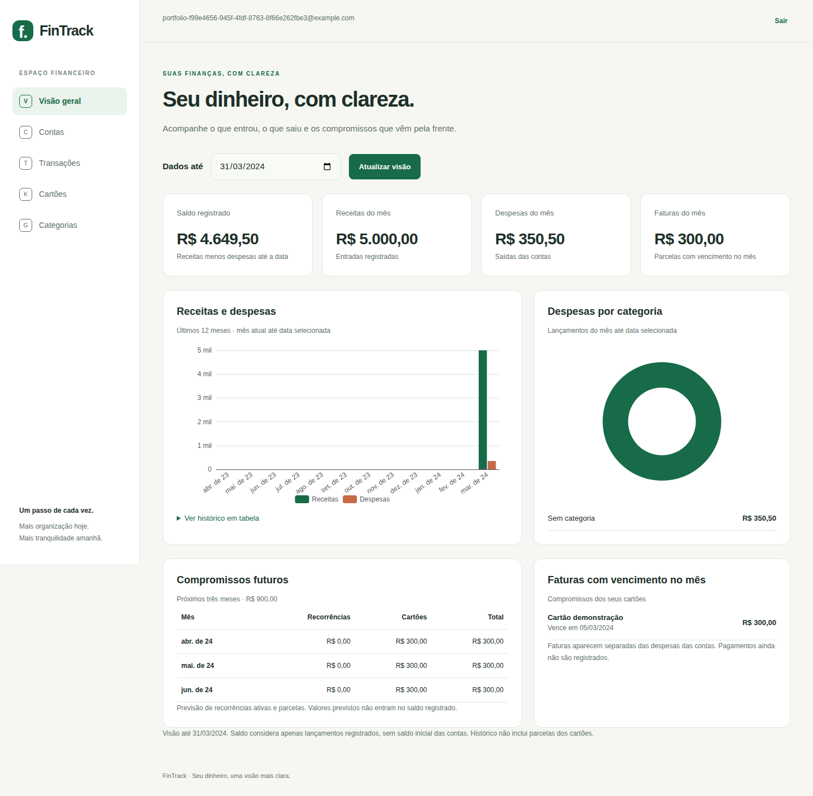
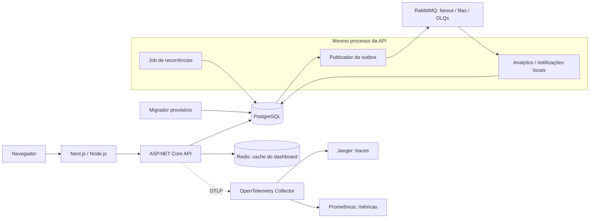

# FinTrack — Personal Finance Platform

Plataforma de finanças pessoais para registrar receitas e despesas, acompanhar
compras parceladas e consultar projeções financeiras. Projeto de portfólio com
backend C#/.NET, frontend Next.js e ambiente completo executado localmente.

Release local **v0.1.0** com imagens Docker, screenshots e vídeo demonstrativo.
Sem GHCR, deploy AWS ou hospedagem pública contínua. Dados da demonstração são
fictícios; banco e credenciais pessoais ficam fora do repositório.

[Executar](#executar-ambiente-completo) · [Demonstração](#demonstração) ·
[API](docs/api/README.md) · [Decisões](docs/decisions/README.md) ·
[Roadmap](docs/personal-finance-platform-roadmap.md)

## Demonstração



[Vídeo WebM](docs/demo/v0.1.0/demo.webm) ·
[Transações](docs/demo/v0.1.0/transactions.png) ·
[Cartões e parcelas](docs/demo/v0.1.0/credit-cards.png) ·
[Evidências da release](docs/releases/v0.1.0.md)

Vídeo mostra cadastro, criação de conta, receita, despesa, compra parcelada e
consulta do dashboard. Não há usuário pré-carregado: cadastre acesso em `/register`.
Para reproduzir, suba stack abaixo e use dados fictícios. Script de gravação e
requisitos estão no [procedimento de release](docs/releases/local-release.md#demonstração-de-portfólio).

## Funcionalidades e limites

| Área | Disponível |
| --- | --- |
| Autenticação | Cadastro/login/logout no frontend, JWT, refresh rotativo, cookies HttpOnly e isolamento por usuário |
| Contas | CRUD na API; criação e listagem no frontend |
| Categorias | Criação, leitura e atualização na API; listagem no frontend |
| Transações | Receitas/despesas manuais pela API e frontend, categoria opcional, listagem |
| Cartões | CRUD na API; criação/listagem, compra parcelada e consulta de faturas no frontend |
| Parcelamento | 1–120 parcelas, distribuição exata dos centavos, calendário por fechamento/vencimento |
| Faturas | Persistência, totais, calendário e limite disponível pela API |
| Recorrências | Criação, consulta, desativação e geração idempotente pela API; job automático configurável |
| Dashboard | Saldo registrado, receitas/despesas, faturas, projeções e gráficos ECharts; cache Redis |
| Mensageria | Outbox transacional, RabbitMQ, dois consumidores locais, deduplicação, retries e DLQ |
| Operação | Compose, testes com containers, observabilidade local e backup/restauração documentados |

Transferências, edição/exclusão de lançamentos, pagamentos de faturas e interface
para administrar recorrências permanecem pendentes. Notificações são registros
locais; não enviam email/push. Recuperação de senha e MFA não estão implementados.
Saldo registrado não representa integração com bancos nem conciliação bancária.

## Arquitetura



Backend é monolítico em camadas: Api compõe endpoints e dependências;
Application define casos de uso e contratos; Domain concentra regras;
Infrastructure implementa persistência e integrações. Jobs/publicador/consumidores
executam na API. PostgreSQL é fonte de verdade; outbox compartilha transação
com escrita financeira. Projeções dos consumidores têm consistência eventual.

Logs JSON ficam no console. Traces e métricas seguem Collector; Redis é
cache descartável. Diagrama representa ambiente local, sem alta disponibilidade.
[ADRs](docs/decisions/README.md) registram alternativas, custos e limitações.

## Stack e estrutura

| Camada | Tecnologias |
| --- | --- |
| Backend | .NET 10, ASP.NET Core, EF Core, Npgsql |
| Frontend | Next.js 16, React 19, TypeScript, Tailwind CSS 4, Zod, ECharts |
| Dados e mensageria | PostgreSQL 17, Redis 7, RabbitMQ 4 |
| Infraestrutura | Docker, Compose, GNU Make; laboratório Terraform opcional |
| Qualidade | xUnit, Testcontainers, Playwright Chromium desktop/mobile, ESLint |
| Observabilidade | OpenTelemetry, Collector, Jaeger, Prometheus |

```text
apps/api/             API, aplicação, domínio, infraestrutura e testes .NET
apps/web/             Frontend, testes e runner Playwright
scripts/              Setup e backup locais
ops/observability/    Configuração Collector e Prometheus
ops/terraform/local/ Laboratório Terraform separado da aplicação
docs/                 ADRs, arquitetura, API, releases, demo e roadmap
.github/workflows/    CI preparado para repositório público
```

## Executar ambiente completo

Requisitos: Docker ativo com containers Linux, Compose v2 com `up --wait`,
GNU Make e OpenSSL. No Windows, use WSL2 com integração Docker. SDK .NET e Node.js
locais não são necessários para esse modo; primeiro build baixa bases e pacotes.

Na raiz do checkout:

```bash
docker info
docker compose version
make setup
make config-check
make full
make status
```

`setup` cria `.env` com segredos aleatórios e permissão 600, preservando arquivo
existente. `config-check` valida sem exibir segredos. `full` constrói imagens,
aguarda healthchecks e aplica migrations antes da API. Migrador encerrado com
código 0 é esperado. Abra **http://localhost:3000**, cadastre acesso e crie conta.

| Serviço | Endereço padrão |
| --- | --- |
| Frontend | http://localhost:3000 |
| API / liveness | http://localhost:5168/health |
| PostgreSQL / Redis | `localhost:5432` / `localhost:6379` |
| RabbitMQ / painel | `localhost:5672` / http://localhost:15672 |
| OTLP gRPC | `localhost:4317` |
| Jaeger / Prometheus | http://localhost:16686 / http://localhost:9090 |

Portas ficam no loopback. `/health` verifica HTTP, não readiness de todas as
dependências. Telemetria pode levar alguns segundos para aparecer.

```bash
make logs       # Ctrl+C encerra acompanhamento
make migrate    # Usa imagem API atual; aplica somente migrations pendentes
make stop       # Encerra containers/rede, preserva volumes
```

PostgreSQL, RabbitMQ e Prometheus usam volumes. Redis e traces Jaeger são voláteis.
Mantenha nome do projeto Compose estável; alterá-lo seleciona outros volumes.
Não use `docker compose down --volumes` no ambiente pessoal. Antes de atualizar,
siga [backup, migrations e retorno de versão](docs/releases/local-release.md).

Para executar imagens de release já disponíveis localmente:
`make images-run IMAGE_TAG=v0.1.0`. Todas as dependências Docker também precisam
estar locais; comando não baixa nem constrói imagens. Para construir uma versão
nova, use `make images-build IMAGE_TAG=NOVA_VERSAO`; preserve tags já entregues.

### Configuração e variáveis

[`.env.example`](.env.example) é referência da configuração Compose. API e
frontend locais têm configuração própria; `.env` da raiz não é carregado por eles.

| Variável | Uso / padrão |
| --- | --- |
| `POSTGRES_DB`, `POSTGRES_USER`, `POSTGRES_PASSWORD` | Banco e credenciais; setup gera senha local |
| `JWT_SIGNING_KEY` | Chave de assinatura, mínimo 32 bytes; setup gera valor aleatório |
| `RABBITMQ_USER`, `RABBITMQ_PASSWORD` | Credenciais do broker; senha gerada alfanumérica adequada à URI |
| `IMAGE_TAG` | Tag de API/migrador/frontend; Make exporta `local` por padrão, use override explícito para release |
| `AUTH_COOKIE_SECURE` | `false` para HTTP local; `true` ao servir frontend por HTTPS |
| `POSTGRES_PORT`, `API_PORT`, `WEB_PORT` | `5432`, `5168`, `3000` |
| `REDIS_PORT`, `DASHBOARD_CACHE_TTL_SECONDS` | `6379`, TTL de `60` segundos |
| `BACKGROUND_JOBS_ENABLED`, `BACKGROUND_JOBS_INTERVAL_SECONDS` | Compose: `true`, intervalo de `60` segundos |
| `MESSAGING_ENABLED` | Compose: `true`; habilita publicador/consumidores |
| `RABBITMQ_PORT`, `RABBITMQ_MANAGEMENT_PORT` | `5672`, `15672` |
| `OBSERVABILITY_ENABLED`, `OTLP_PORT` | Compose: `true`, OTLP gRPC em `4317` |
| `JAEGER_PORT`, `PROMETHEUS_PORT` | `16686`, `9090` |
| `API_URL` | Frontend servidor: padrão local `http://localhost:5168`; Compose define `http://api:8080` |

Para conflito de portas Docker, ajuste `.env`. Não versione segredos, dumps ou
saída resolvida de `docker compose config`; use `config --quiet`.
Alterar senha PostgreSQL no `.env` não modifica senha de banco já inicializado.

### Problemas comuns

- Startup: `make config-check` e `docker compose logs --tail=100 postgres migrate api web rabbitmq`.
- JWT ausente: use `make setup` em checkout novo; arquivo existente precisa ser revisado.
- Porta ocupada: pare processo concorrente ou ajuste portas antes de iniciar.
- API Docker usa `postgres:5432`; API no host usa `localhost` e porta publicada.
- Métricas: consulte `/targets` no Prometheus; gere requests e procure `fintrack-api` no Jaeger.

## Desenvolvimento local

Requisitos adicionais: SDK .NET 10, Node.js 24 e npm. Serviços de dados seguem
em Docker. Na raiz, prepare `.env` e pare API/web Docker ao selecionar modo local:

```bash
make setup
make dev-db
npm --prefix apps/web ci
```

Configure User Secrets da API com valores do `.env`, usando porta publicada.
Substitua placeholders abaixo pelos seus valores:

```bash
dotnet user-secrets set "ConnectionStrings:Database" "Host=localhost;Port=5432;Database=SEU_BANCO;Username=SEU_USUARIO;Password=SUA_SENHA" --project apps/api/src/FinTrack.Api
dotnet user-secrets set "Jwt:SigningKey" "SUA_CHAVE_COM_PELO_MENOS_32_BYTES" --project apps/api/src/FinTrack.Api
make dev-migrate
make dev-api
```

Em outro terminal, execute `make dev-web`. API fica em `5168`, web em `3000`.
`make dev-api` habilita Redis e jobs; SDK direto mantém recursos opcionais
conforme [appsettings](apps/api/src/FinTrack.Api/appsettings.json).
Mensageria local exige `Messaging__Enabled=true` e `ConnectionStrings__RabbitMq`
configurados no processo da API; observabilidade exporta ao definir
`Observability__OtlpEndpoint=http://127.0.0.1:4317` e iniciar `make dev-observability`.

Para outras portas: `make dev-api API_PORT=5169 REDIS_PORT=6380` e
`make dev-web WEB_PORT=3001`. Alinhe Redis à porta Compose; configure
`API_URL=http://localhost:5169` em `apps/web/.env.local` se API mudar de porta.
Encerre processos locais antes de voltar a `make full`; ambos os modos usam
mesmo banco/volume. Uma instância Next.js dev por checkout.

## Testes e CI

Execute menor escopo pertinente à alteração. Integrações exigem Docker acessível
e criam serviços descartáveis; não usam banco pessoal. Exemplos:

```bash
# Um cenário/classe diretamente afetado:
dotnet test apps/api/tests/FinTrack.UnitTests --filter FullyQualifiedName~AccountTests
# Mensageria (unitários + integrações pertinentes):
make test-messaging
# Frontend:
npm --prefix apps/web test
npm --prefix apps/web run lint
npm --prefix apps/web run typecheck
```

Para mudanças que justifiquem escopo correspondente: `make test-fast` executa
unitários/arquitetura; `make test-integration` cobre integrações; `make test-api`
cobre backend completo. E2E usa Chromium desktop/mobile com banco/cache isolados:

```bash
cd apps/web
npm ci
npx playwright install --with-deps chromium
npm run e2e
```

Runner separa build `.next-e2e`, portas e dados; encerra recursos ao terminar.
Falhas retêm traces/screenshots/vídeos locais. Na pasta web, `npm run e2e:report`
abre relatório. Não executar builds frontend e E2E em paralelo no mesmo checkout.

[CI](.github/workflows/ci.yml) está preparado para repositório público com runners
padrão; jobs ignoram repositórios privados. Não publica imagens nem faz deploy.
`make ci-install`, `make ci-install-e2e` e `make ci` oferecem validação ampla
opcional; não são exigência para toda alteração. Evidências históricas estão na
[release v0.1.0](docs/releases/v0.1.0.md); revisão da fase 33 valida documentação,
sem repetir testes da aplicação ou afirmar nova execução remota.

## API e decisões de sistema

[Guia da API](docs/api/README.md) lista endpoints, autenticação, exemplos JSON e
respostas. Implementação usa Minimal APIs; não há Swagger UI/OpenAPI HTTP exposto
atualmente. [Program.cs](apps/api/src/FinTrack.Api/Program.cs) define rotas atuais.

[Catálogo de 23 ADRs](docs/decisions/README.md) explica camadas, persistência,
autenticação, calendário financeiro, cache, jobs, outbox, observabilidade e entrega.
[Comparação RabbitMQ/SQS](docs/architecture/rabbitmq-and-sqs.md) e
[laboratório Terraform Docker](ops/terraform/local/README.md) complementam estudos.
Laboratório é opcional, isolado e não administra recursos da aplicação.

## Cloud conceitual

[Estudo AWS](docs/architecture/aws-conceptual.md) e
[diagrama proposto](docs/diagrams/aws-conceptual.md) mapeiam stack para alternativas
como ECS, RDS, ElastiCache e SQS. **Não houve deploy AWS.** Documentação não comprova
SLA, failover ou desempenho em cloud; execução funcional permanece local.

## Roadmap e continuidade

[Roadmap detalhado](docs/personal-finance-platform-roadmap.md) reúne fases e
pendências. Fases 31–33 consolidam release, ADRs e apresentação do projeto;
isso não encerra lacunas funcionais de fases anteriores. Próximos trabalhos
incluem transferências, gestão completa de lançamentos e pagamentos de faturas.

[Histórico de implementação](docs/implementation-history.md) preserva registros
anteriores com contexto de cada fase; [auditoria de 13/10/2026](docs/project-audit-2026-10-13.md)
é fotografia daquela data, não certificação do estado atual.
