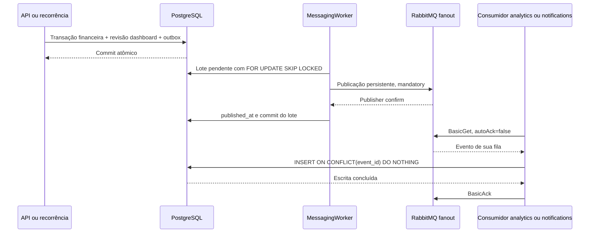

# Mensageria local e comparação com SQS — Fase 29

**Implementação real: RabbitMQ local. SQS/SNS: estudo, não implantado.**
Revisão: 13/10/2026. Nenhuma fila, conta ou credencial AWS criada.

## Fluxo implementado



Exchange durável `fintrack.transaction-created.v1` entrega cópia a cada fila
quorum durável: `fintrack.analytics.v1` e `fintrack.notifications.v1`. Cada uma
tem DLQ própria com sufixo `.dead`. Produtor e consumidores executam dentro da
API; não existem processos separados de workers nem envio real de email/push.

Outbox é gravada na mesma transação PostgreSQL do lançamento financeiro;
rollback elimina ambos. Broker indisponível deixa eventos pendentes, sem exigir
transação distribuída. Worker publica até 50 eventos por lote, mantém locks até
confirmações/commit e depois tenta consumir até 50 mensagens de cada fila por
ciclo. Ciclo normal aguarda um segundo; falha de conexão/ciclo aguarda dois.

Publisher confirm comprova aceitação pelo broker, não execução do consumidor.
`mandatory` detecta publicação sem rota para filas; não comprova processamento
em ambas. Confirm seguido de crash antes do commit pode republicar evento;
escrita do consumidor seguida de crash antes do ack também permite redelivery.
Entrega é pelo menos uma vez; efeitos idempotentes usam chave `event_id` em cada
tabela de projeção. Não existe garantia global de exactly-once.
[Confirms e acknowledgements](https://www.rabbitmq.com/docs/confirms).

Consumidor valida versão/payload. JSON inválido segue diretamente à DLQ via
`BasicNack(requeue:false)`. Falha de processamento recebe três tentativas por
entrega, com pausas de 250 e 500 ms; após esgotar, segue à DLQ. Crash/conexão
interrompida antes do ack pode reenviar mensagem e reiniciar contagem local de
tentativas. Essa contagem não é limite persistente de redeliveries. DLQs usam
dead-lettering at-least-once e `reject-publish`, conforme
[ADR 019](../decisions/019-transaction-messaging.md).

## Demonstração reproduzível sem dados pessoais

Com Docker ativo, execute somente testes relacionados:

```bash
make test-messaging
```

Testcontainers inicia PostgreSQL/RabbitMQ descartáveis com portas aleatórias,
aplica migrations e limpa containers ao final. Não usa `.env`, banco ou filas
pessoais. Arquivos de referência:
[integrações](../../apps/api/tests/FinTrack.IntegrationTests/MessagingTests.cs)
e [unitários](../../apps/api/tests/FinTrack.UnitTests/Messaging/MessagingTests.cs).

| Cenário existente | Evidência verificada |
| --- | --- |
| `CommittedManualTransaction_FanoutAndDuplicateDelivery_ProduceOneProjectionPerConsumer` | Duas filas recebem evento; republicação gera um efeito por consumidor |
| `FailedPublish_PreservesPendingOutbox_AndRecoveryDelivers` | Canal fechado não marca publicação; canal recuperado entrega evento |
| `InvalidEvent_GoesToEachDeadLetterQueue_WithoutProjection` | Payload inválido aparece nas duas DLQs sem gravar projeções |
| `ConsumerDatabaseFailure_ExhaustsRetriesAndMovesEventToDeadLetterQueue` | Falha SQL esgota tentativas; analytics vai à DLQ enquanto notifications conclui |
| `RecurringGeneration_ConcurrentPublishers_EmitOneEventPerOccurrence` | Geração repetida e produtores concorrentes não criam evento extra por ocorrência |
| `SynchronousSave_PersistsOutboxWithTransaction` | SaveChanges síncrono também persiste outbox |
| `RolledBackTransaction_LeavesNoOutboxOrConsumerEffects` | Rollback deixa outbox/projeção vazias |
| `BackgroundWorker_DeliversAndStopsCleanly` | Worker real entrega e encerra limpo |
| `RequestOutboxProducerAndConsumers_ShareTraceAcrossDelayedPublication` | Trace acompanha requisição, outbox, produtor e ambos os consumidores |

Unitários validam ativação opcional do worker e URI exigida quando habilitado.
Teste de falha SQL altera tabela somente no banco descartável; não repetir isso
no ambiente pessoal. Teste de duplicata simula republicação após confirmação;
não representa ensaio completo de crash de processo/rede.

## Diagnóstico no ambiente local existente

Stack completa usa `MESSAGING_ENABLED=true` e credenciais RabbitMQ do `.env`.
Crie conta e lançamento manual pela interface; aguarde ciclo do worker. Outbox
publicada e projeções crescem; filas podem ficar vazias porque consumo é rápido.
Para consultar somente contagens, sem payload/usuário/valor financeiro:

```bash
docker compose exec -T postgres sh -c 'psql -U "$POSTGRES_USER" -d "$POSTGRES_DB"' < docs/database/messaging-diagnostics.sql
docker compose exec rabbitmq rabbitmqctl list_queues name messages_ready messages_unacknowledged
docker compose logs --tail=100 api rabbitmq
```

UI RabbitMQ: http://localhost:15672, credenciais do `.env`. Consulte filas e
contagens; não purgue filas nem retire mensagens para validar operação pessoal.
Sem backlog, contagem zero é normal. `published_at` significa publicação
confirmada, não sucesso de todos os efeitos; compare também projeções e DLQs.
Métricas locais: `fintrack_messaging_published_total`,
`fintrack_messaging_consumed_total`, `fintrack_messaging_failures_total` e
`fintrack_messaging_dead_letters_total`; não equivalem ao tamanho das filas.

Não há endpoint de replay, retenção automática da outbox ou notificações externas.
Replay exigiria corrigir causa, preservar identificador original e escolher fila
afetada; permanece procedimento futuro, sem comando que altere dados nesta fase.
Quorum em broker de nó único não elimina risco de falha do computador.

## RabbitMQ real versus SQS conceitual

| Tema | RabbitMQ implementado | SQS Standard proposto |
| --- | --- | --- |
| Queue vs pub/sub | Exchange fanout copia para filas distintas; consumidores da mesma fila competem | Uma fila não faz broadcast; SNS com fila por consumidor preservaria fanout |
| Publicação | AMQP persistente, mandatory e publisher confirms | API SendMessage ou Publish SNS; confirmar envio antes de marcar outbox |
| Recebimento | BasicGet sem auto-ack; polling de ciclo local | ReceiveMessage; long polling configurável |
| Conclusão | Ack somente após efeito PostgreSQL | DeleteMessage com receipt handle da entrega somente após efeito PostgreSQL |
| Mensagem em processamento | Unacked; fechamento de canal/conexão permite redelivery | Visibility timeout oculta temporariamente; expiração sem delete permite nova entrega |
| Tentativas | Três tentativas locais por entrega; inválido vai direto à DLQ | Política redrive usa maxReceiveCount; tentativas internas não contam como novos receives |
| Duplicatas | Outbox e ack/commit têm janelas de duplicação | Standard admite duplicatas; idempotência no banco continua necessária |
| Ordem | Não depender de ordem global com concorrência/retries | Standard oferece ordem best-effort; FIFO seria decisão distinta por grupo |
| DLQ | Nack sem requeue e configuração dead-letter por fila | Redrive policy e DLQ compatível com tipo da fila; retenção/replay configurados |
| Operação | Volume/broker local e conexão AMQP | Serviço gerenciado regional; IAM, quotas, rede e cobrança por uso |

Uma fila SQS compartilhada por analytics e notifications distribuiria eventos
entre eles, em vez de entregar cópia a ambos. Proposta da Fase 28 adiciona SNS
e filas próprias: [fanout SNS/SQS](https://docs.aws.amazon.com/sns/latest/dg/sns-sqs-as-subscriber.html).
Aceitação no SNS não comprova consumo das filas; efeitos continuam assíncronos.

Visibility timeout não confirma processamento nem garante exclusão absoluta em
SQS Standard. Consumidor precisa terminar e deletar antes do prazo ou estender
com `ChangeMessageVisibility`; crash pode levar à nova entrega. Receipt handle
é da entrega, não identidade de negócio. Preserve `event_id` para deduplicar.
[DeleteMessage e receipt handle](https://docs.aws.amazon.com/AWSSimpleQueueService/latest/APIReference/API_DeleteMessage.html).
[Visibility timeout](https://docs.aws.amazon.com/AWSSimpleQueueService/latest/SQSDeveloperGuide/sqs-visibility-timeout.html)
e [at-least-once](https://docs.aws.amazon.com/AWSSimpleQueueService/latest/SQSDeveloperGuide/standard-queues-at-least-once-delivery.html).

Long polling usa `WaitTimeSeconds > 0`, até 20 segundos; espera mensagem ou
expiração e reduz respostas vazias. Não é push, não determina prazo de
processamento e não substitui visibility timeout. Cliente HTTP precisa de
timeout maior que espera configurada. Consumidores por fila evitariam bloquear
outra fila enquanto uma está vazia.
[Short e long polling](https://docs.aws.amazon.com/AWSSimpleQueueService/latest/SQSDeveloperGuide/sqs-short-and-long-polling.html)
e [configuração do cliente](https://docs.aws.amazon.com/AWSSimpleQueueService/latest/SQSDeveloperGuide/best-practices-setting-up-long-polling.html).

[SQS Standard](https://docs.aws.amazon.com/AWSSimpleQueueService/latest/SQSDeveloperGuide/standard-queues.html)
não garante ordem estrita. SQS redrive usa `maxReceiveCount` para transferir mensagens à DLQ após número
configurado de recebimentos sem conclusão. Não equivale às três tentativas SQL
do worker atual. Em Standard, retenção na DLQ considera timestamp original de
envio; configure retenção DLQ maior que origem. Replay exige corrigir causa e
continuar idempotente, evitando ciclos permanentes.
[Políticas e retenção DLQ](https://docs.aws.amazon.com/AWSSimpleQueueService/latest/SQSDeveloperGuide/sqs-dead-letter-queues.html).

## Decisão

[ADR 025](../decisions/025-local-messaging-sqs-comparison.md): manter RabbitMQ,
outbox e consumidores existentes; SQS somente estudo. Migração futura exigiria
novo transporte, configuração de fanout, ack/delete, visibility, polling,
redrive, IAM e testes de falhas. Não instalamos SDK AWS ou criamos filas.

Validação local: 5 unitários e 9 integrações de mensageria aprovados, sem skips.
Nenhuma suíte não relacionada foi executada.
