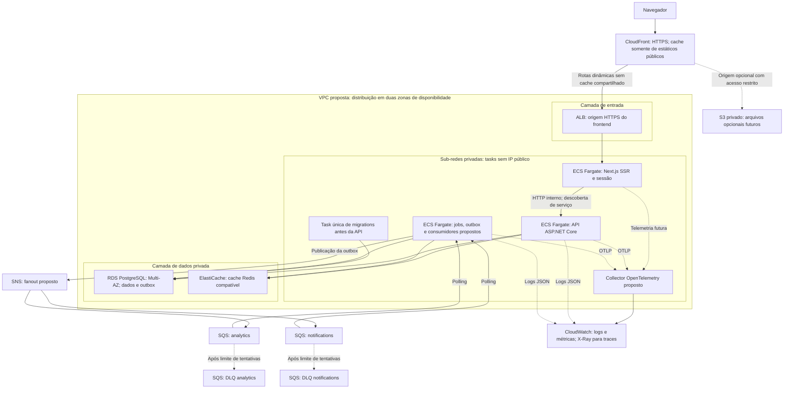

# Arquitetura AWS conceitual — Fase 28

**Proposta de estudo, não implantada.** Nenhuma conta, credencial ou recurso AWS
foi criado. Ambiente executável continua sendo Docker Compose local.

SQS, SNS, S3 e observabilidade são serviços regionais acessados por APIs; posição
fora da VPC não significa exposição pública dos dados. Políticas IAM, TLS e
endpoints privados/egress controlado precisariam ser definidos. Diagrama omite
DNS, certificados, distribuição de imagens, secrets e rotas de saída; são
dependências de uma implantação futura, descritas no estudo.

Tasks web/API teriam réplicas em duas AZs. Worker representa papéis lógicos;
separá-los da API requer mudança de composição do código atual. Migrations
seriam uma execução única controlada pelo processo de entrega. RDS Multi-AZ
representa primário e standby, sem prometer consultas no standby.

Detalhes: [estudo e comparação](../architecture/aws-conceptual.md) e
[ADR 024](../decisions/024-cloud-conceptual-architecture.md).
